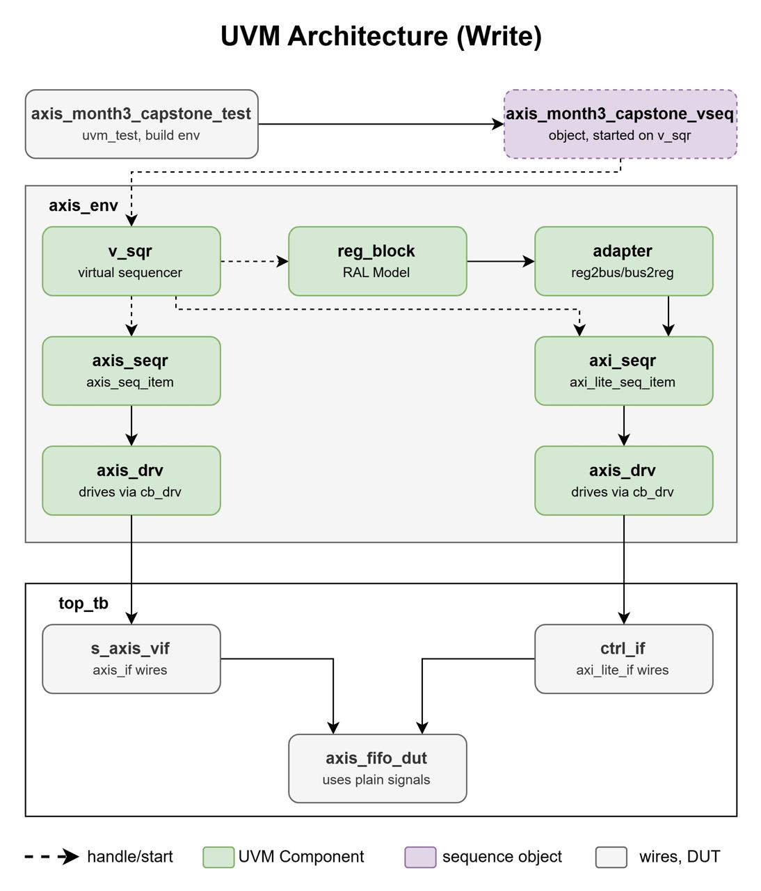
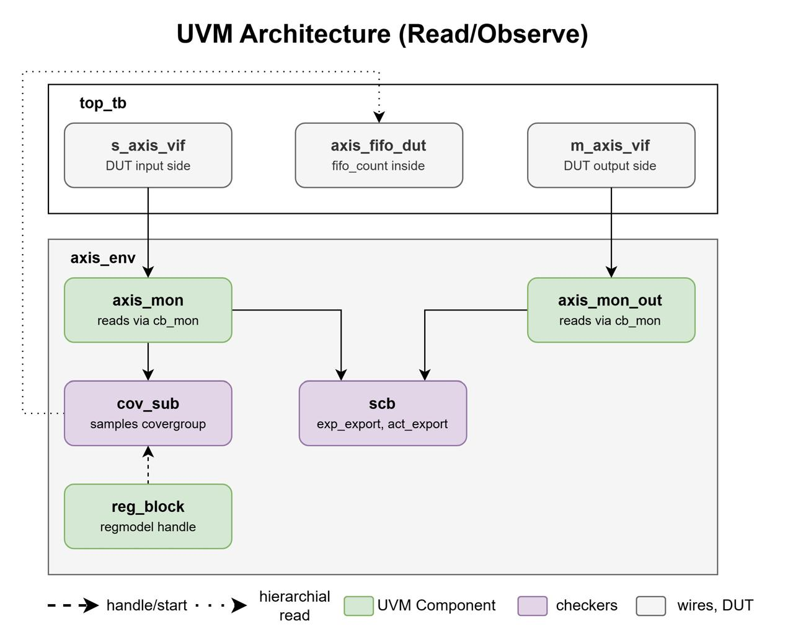

# AXI-Stream FIFO: UVM Verification Environment

## Overview
A UVM 1.2 testbench (Vivado XSim) that verifies an AXI-Stream FIFO (16 entries,
32-bit data) with a control/status register interface. The goal is to practice
and demonstrate core UVM concepts: sequences, drivers, monitors, a scoreboard,
functional coverage, a register model (RAL), a virtual sequencer, and SVA.

Note: the control interface is named `axi_lite_if`, but its signals (`psel`,
`penable`, `pready`, `pwrite`, `paddr`) follow the APB protocol.

## DUT summary
- Input stream: `s_axis_if`, output stream: `m_axis_if`
- Registers: `0x00` ctrl (bit0 enable, bit1 soft reset, bits[3:2] mode),
  `0x04` status (bit0 full, bit1 empty)
- Note: the `mode` bits are stored but do not change DUT behavior.

## Architecture

- Stimulus: `axis_month3_capstone_vseq` runs on `v_sqr`, starts the RAL
  configuration sequence on `axi_seqr` and the traffic sequence on `axis_seqr`.
- Observation: `axis_mon` watches the DUT input, `axis_mon_out` watches the output.
- Checking: `scb` compares input packets against output packets;
  `cov_sub` samples the covergroup.

## Test scenario
- 3 batches, one per mode (0, 1, 2), programmed through RAL frontdoor writes
- 200 packets per batch, length 1-16 words, stall delay 0-10 cycles
- Output `tready` toggles every 5-40 cycles to create backpressure

## Verification Plan
| Feature | How it is checked |
|---|---|
| Data integrity and packet order | Scoreboard: packets seen at the input monitor vs. output monitor |
| AXI-Stream protocol rules | SVA in `axis_if`: hold-until-ready, no X/Z on handshake and data |
| Register access and config | RAL model, frontdoor writes/reads, read-back |
| Functional scenarios | Covergroup: length, stall, mode, FIFO state, mode x FIFO cross |
| Checker trustworthiness | Deliberate bugs injected into the DUT (see below) |

## Results
- Packets checked: 600 (200 x 3 modes), mismatches: 0
- Assertion failures (`[AXIS]`) on the clean DUT: 0
- Coverage per coverpoint: len 100%, stall 100%, mode 100%, fifo 66.7%, cross 57.1%
  (total 84.76%)
- Checker validation: with a deliberate `tdata ^ 1` bug the scoreboard reported
  600 mismatches; with a deliberate tdata change while `tready` is low, assertion
  `a_hold_until_ready` fired.

### Uncovered bins
1. `FIFO_FULL` (cp_fifo_status, and the two full bins of the cross). The monitor
   reports a packet when its last beat is accepted, and the DUT only accepts a
   beat when the FIFO is not full, so `fifo_count` is never 16 at the sample point.
2. One more cross bin: TODO (identify with the per-bin counter).
3. Ignored by design: bypass mode with MID/FULL FIFO state.

## Bugs Found
Design/testbench bugs:
- **Driver sent each non-last beat twice.** Found because the beat count was 415
  for 25 packets where about 212 were expected (25 x 8.5 average length). Cause:
  an extra clock wait after the handshake. Fixed by removing it.
  TODO: add the beat count after the fix.
- **Scoreboard counted items without comparing.** Fixed by adding `axis_mon_out`
  and comparing each packet (length and every word) against the input side.
- **Coverage stuck at 27.86%.** The monitor emitted one item per beat with default
  field values. Fixed by building one item per packet (length, measured stall).
- **Virtual interface null.** The `config_db` path used class names, but paths
  match instance names (`axis_drv`, `axis_mon`).
- **Compile errors:** wrong port connection (`seq_item_port` to `analysis_export`),
  and `write(axis_seq_item)` missing the argument name.

## How to Run
1. Create a Vivado project and add `axis_month3_capstone_test.sv` as a simulation source.
2. Set `top_tb` as the simulation top module.
3. Run behavioral simulation (UVM 1.2 package from XSim).
4. TODO: Vivado version, any simulation settings, expected runtime.
5. Check the log for the final report and search for `[AXIS]` to see assertion errors.

## Limitations / Future Work
- `FIFO_FULL` is not covered: sample the maximum occupancy between packets
  instead of the value at the last beat.
- The scoreboard does not check the driver (expected data comes from the input monitor).
- Assertion failures are plain `$error` messages and do not fail the UVM report.
- The `mode` field has no effect in the DUT, so mode coverage is configuration coverage.
- No monitor or protocol assertions on the control interface (`cb_mon` there is unused).
- Coverage reads `top_tb.dut.fifo_count` by hierarchical reference (not portable).
- Possible extension: an asynchronous FIFO with clock-domain crossing.